<!-- animated contribution graph: real data, boxes reveal cell by cell
     (regenerated daily by .github/workflows/update-profile-art.yml) -->

<h3><code>aditya@github ~ $ ./contributions.sh</code></h3>

 
 

<!-- hero: monochrome ASCII portrait (types in) beside a neofetch-style card.
     widths add up to the graph's 860 and both panels land at the same height.
     portrait: drop a photo at ./source-photo.png and the workflow rebuilds it
     card:     python scripts/make_info_card.py -->

<h3><code>aditya@github ~ $ whoami</code></h3>

<table>
<tr>
<td valign="top"></td>
<td valign="top"></td>
</tr>
</table>

 
 

<h3><code>aditya@github ~ $ cat about.txt</code></h3>

<b>Full-Stack Developer · AI & Edge Engineer · Systems & Computer Vision</b>

I engineer production-grade systems bridging intelligent machine learning models with low-latency edge runtimes and responsive full-stack applications. Certified by Google and Microsoft in web development, my work spans real-time computer vision surveillance, edge speech recognition & wake-phrase spotting, legal document NLP, and modern distributed web platforms.

| Intelligence & Vision | Edge & Systems | Full-Stack Delivery |
| :---: | :---: | :---: |
| Real-time threat detection (DrishtiGuard) | Low-latency voice activation & streaming ASR | Modern React & Next.js user interfaces |
| Multi-disease classification (ArogyaDrishti) | Ultra-low latency keyword spotting models | Robust FastAPI & Django REST backends |
| Legal judgement parsing (BiLSTM-CRF) | Unreal Engine & audio DSP pipelines | Docker, Supabase, PostgreSQL architectures |

 

<h3><code>aditya@github ~ $ ls ~/projects</code></h3>

| Project | Highlights & Architecture | Stack |
| :--- | :--- | :---: |
| [DrishtiGuard](https://github.com/adisingh592/Drishti-gaurd) | Smart Vision, Safer India. Real-time surveillance AI detecting weapons, crowd surges & anomalies | `TypeScript` `React` `Python` `YOLO` |
| [sih-voice-kws](https://github.com/adisingh592/Asr-Model) | Split-architecture (Edge + Server) streaming voice activator & low-latency speech recognizer | `C` `Python` `Edge AI` `DSP` |
| [ArogyaDrishti](https://github.com/adisingh592/ArogyaDrishti) | Multi-disease detection, clinical imaging diagnosis & personalized health triage system | `Python` `PyTorch` `OpenCV` `FastAPI` |
| [KhusKhus-KWS](https://github.com/adisingh592/kws-model) | Ultra-low-latency keyword spotting model optimized for constrained edge audio hardware | `Python` `PyTorch` `Edge AI` |
| [Legal-Judgement-Analysis](https://github.com/adisingh592/legal-judgement-analysis) | Rhetorical segmenter & summarizer for judicial verdicts via custom Hierarchical BiLSTM-CRF | `Python` `BiLSTM-CRF` `NLP` |
| [Jal-Mitra](https://github.com/adisingh592/JalMitra_PythonProject) | Smart municipal water supply monitoring, telemetry tracking, leak alerting & consumer billing | `TypeScript` `Python` `IoT` |
| [Velvet-Vine](https://github.com/adisingh592/Valvet_vine) | High-performance fashion discovery & dynamic affiliate platform with responsive modern UI | `TypeScript` `React` `Tailwind` |
| [Mindmate](https://github.com/adisingh592/Mindmate) | Cognitive wellness companion integrating conversational AI with mood analytics | `TypeScript` `React` `Web AI` |

 

<h3><code>aditya@github ~ $ ./stack.sh</code></h3>

 
 

<h3><code>aditya@github ~ $ ./links.sh</code></h3>

 

 

